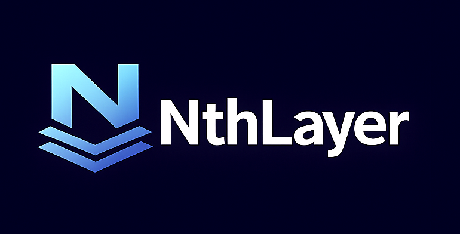

<div align="center">
  <a href="https://nthlayer.io">
    
  </a>
</div>

# NthLayer

**Your dashboards say it's up. NthLayer tells you whether it was right.**

Agents, rules and people make calls that no test can check: a triage, an approval, a release. NthLayer records each one, waits for the outcome, and turns how often they hold up into SLOs and alerts in the Prometheus and Grafana you already run.

[](LICENSE)
[](https://nthlayer.io)

This repository is the **project front door and ecosystem hub**. Implementation lives in the per-tier repos listed under [The ecosystem](#the-ecosystem).

## Back pressure for decisions that have no compiler

Pipelines scale by turning judgment into verification. A type checker, a test suite or a simulator says no, and the loop moves on.

Whatever can't be verified that way is still a decision: a release, a migration, a destructive API call, an alert triage. Most systems never measure whether those decisions hold up. NthLayer does, and shows how much of your system still runs on judgment.

## Starting with your AI SRE

In operations, the evidence shows up on its own. The alert was real or it wasn't. The service recovered or it didn't. And the on-call who sees it is already the reviewer.

So every decision an AI SRE makes (to triage, suppress or remediate) is recorded as a **verdict**, then settled: confirmed when a positive outcome is posted, overridden when someone on the team rejects it where they already work, or expired after seven days with neither. When its decisions stop holding up, its **judgment SLO** (a target for how often they hold up) breaches. The manifest's declared breach action, `reduce_autonomy`, tells your AI SRE's platform to rein it in. NthLayer executes nothing.

[Walk through the full scenario →](https://nthlayer.io/walkthrough/)

The same record works for any decision no test can check: refunds, cleanups, schema changes, releases.

## What it measures

Classical observability tells you a service was up, fast and cheap. Judgment SLOs tell you whether its decisions were right.

- **Reversal rate.** How often a decision is overturned. Today this is overrides ÷ decisions, from Prometheus counters exposed by your AI SRE (via its shim) and the override adapter.
- **High-confidence failure rate.** How often a high-confidence decision is wrong. Those are the decisions that skip the review that would have caught them.
- **Calibration.** When the service says it is 80% confident, whether it is right 80% of the time.
- **Override rate, feedback latency, segments, stability and audit backlog.** Whether humans are stepping in more or less, how long until you can know a decision was right, and whether quality holds across customer tiers and model updates.

## How it works

Declare what "right" means, compile it into the monitoring you already run, then record decisions against it.

NthLayer works in seven stages. **Define** (the OpenSRM manifest) and **Generate** (`nthlayer-generate`) happen at build time and are stable. **Observe**, **Measure**, **Correlate** and **Learn** run at runtime. **Respond** also runs at runtime but only proposes: it records what it would do and opens a case, and a human acts on your systems.

**Declare.** In the manifest, any service that makes decisions has the type `ai-gate`, even when the decider is a rule engine or a human approver. The manifest follows the open [OpenSRM spec][opensrm] and carries classical SLOs for whether the service is up, and judgment SLOs for whether its decisions are right.

```yaml
spec:
  service: { name: ai-sre, type: ai-gate }
  judgment_slo:
    - service: ai-sre
      judgment_type: reversal_rate
      measurement: { window: 7d, source: lineage }
      target: { maximum_reversal_rate: 0.05 }
    - service: ai-sre
      judgment_type: high_confidence_failure
      measurement: { confidence_threshold: 0.9, window: 30d }
      target: { maximum_failure_rate: 0.02 }
```

**Compile.** `nthlayer apply` turns the manifest into Prometheus recording rules, dashboards, docs, Backstage entities and two kinds of alert: breach, and not-evaluable. A not-evaluable alert fires when a bound can't be measured at all, so it is reported rather than treated as healthy. The compiler is deterministic and needs no runtime. The same step runs in CI through this repo's GitHub Action.

**Run.** The runtime is three tiers that talk only over HTTP, plus an adapter for human overrides. Decisions arrive as an HTTP `POST /verdicts` to core, as a plain verdict or a CloudEvents envelope. Overrides go to the adapter, which binds each one to its verdict by decision ID. A verdict's decision is written once; its outcome is settled once, later.

NthLayer sits beside the loop, not inside it. It doesn't run your agents or ask them to grade themselves, so it measures your AI SRE the same way no matter who built it, from records you own.

## The same conclusion, from another domain

In April 2026 NVIDIA open-sourced [Auto Ontology](https://github.com/NVIDIA/auto-ontology), a semantic layer for agents that answer questions over enterprise data. Its README opens with the premise NthLayer is built on: agents can already retrieve and act, but "reliability gates agentic analytics: a revenue metric answered faster is worth nothing if the number is wrong." Its answer is a layer between the agent and the data it queries, built on certified definitions, provenance and corrections fed back into it.

We think that's the right call, and it's good to see it reached independently, at NVIDIA's scale, for data rather than operations. The two layers answer different questions:

- **Before the decision:** a semantic layer tells the agent what the data means and which definitions are trusted.
- **After the decision:** NthLayer records each decision as a verdict and settles it against what happened: confirmed, overridden by a human, or expired with no signal. The rate of overrides is held to a judgment SLO.

Auto Ontology's README names the loop that joins them: "fold certified corrections and usage back into the ontology". A reviewer correcting a generated query has the same shape as an on-call engineer overriding an AI SRE: an override event with a `reviewer` and a `corrected_action`. NthLayer's flagship case is operations, but recording whether a decision held up doesn't depend on the domain.

## Get started

Start with the compiler. It needs nothing deployed.

```bash
pip install nthlayer-generate
nthlayer init
nthlayer apply service.yaml
```

In CI, use this repo's GitHub Action:

```yaml
- uses: rsionnach/nthlayer@v1
  with:
    command: apply
    service: service.yaml
```

To run the full runtime instead:

```bash
pip install nthlayer   # generate + core + workers + bench
nthlayer-core serve
nthlayer-bench --core-url http://localhost:8000
```

- **Evaluating the idea:** read the [OpenSRM spec][opensrm], starting with the judgment SLO section.
- **Seeing it work:** step through the [AI SRE walkthrough](https://nthlayer.io/walkthrough/).
- **Standing up the runtime:** follow [`nthlayer-core/docs/deploying.md`](https://github.com/rsionnach/nthlayer-core/blob/main/docs/deploying.md), from install to a verdict round-tripping through a running server.
- **Why this matters:** read the [research](https://nthlayer.io/research/) on what today's AI observability tools measure, and what they miss.

## The ecosystem

All open source. Each repo keeps its own changelog, and an integration test across the three runtime tiers runs nightly from this repo.

| Repo | Role | Status |
|---|---|---|
| [`opensrm`][opensrm] | The OpenSRM specification: the manifest format for declaring reliability, including judgment SLOs. | v2 draft. Migrate v1 manifests with `nthlayer migrate-manifest`. |
| [`nthlayer-generate`][generate] | The deterministic compiler: manifests → recording rules, alerts, dashboards, docs, Backstage entities. | Stable, CI-ready, in production use |
| [`nthlayer-common`][common] | Shared library: verdict model, manifest parser, LLM wrapper, CoreAPIClient. Imported by every other repo. | Stable on the 5.x line |
| [`nthlayer-core`][core] | **Tier 1.** Verdict store, case management and the HTTP API. | Implemented, running in evaluation deployments |
| [`nthlayer-workers`][workers] | **Tier 2.** Five runtime modules: `observe` and `measure` assess SLOs and judgment SLOs against Prometheus, `correlate` groups related events into situations, `respond` proposes actions for a human to approve and run, and `learn` resolves outcomes and proposes manifest changes for human review. | Implemented. `respond` proposes only: execution, notifications and escalation are not wired yet. |
| [`nthlayer-bench`][bench] | **Tier 3.** Terminal UI for the moments that need a human. | Usable against a running core |
| [`nthlayer-override-adapter`][adapter] | Ingests human overrides from Slack, Jira, a review UI or any webhook, and binds each one to its verdict by decision ID. | Early. HTTP, batch and webhook ingestion work. |

## What's in this repo

- **GitHub Action** (`action.yml`): wraps `nthlayer-generate` for CI/CD pipelines via `uses: rsionnach/nthlayer@<tag>`.
- **PyPI meta-package** (`meta-package/`): source for `pip install nthlayer`. Dependency-only; installs generate, core, workers and bench within compatible version ranges.
- **Integration tests** (`test/`): three-tier integration test infrastructure (`integration-three-tier.sh`, fake-service exporters, a docker-compose stack with Prometheus, Grafana and Alertmanager) that verifies the runtime end to end.
- **Demo materials** (`demo/`): a runnable cascading-failure scenario, the demo orchestrator (`demo.sh`) and example OpenSRM manifests.
- **Specifications** (`docs/specs/`): current NthLayer architectural specs.
- **Roadmap** (`docs/roadmap/`): proposed and upcoming features.
- **Archived specs** (`docs/archived-specs/`): superseded or shipped designs (see `docs/archived-specs/README.md` for archival criteria).
- **Design docs** (`docs/superpowers/`): per-phase plans and per-component design specs, including the [three-tier architecture decision (2026-04-21)][tier-decision] and the [repo consolidation rationale (2026-04-21)][consol].
- **Operational docs** (`docs/`): testing conventions, cost optimisation, metrics contract.
- **CI workflows** (`.github/workflows/`): docs site build, meta-package release, the nightly cross-repo three-tier integration test, Docker image publish.

## Contributing

Each implementation repo has its own contributor guide, test suite and `CLAUDE.md`. Pick the tier relevant to your interest and open a PR there. Changes to the integration tests, demo, Action or meta-package belong here; see [CONTRIBUTING.md](CONTRIBUTING.md).

## Licence

Apache 2.0. See [LICENSE](LICENSE).

[opensrm]: https://github.com/rsionnach/opensrm
[common]: https://github.com/rsionnach/nthlayer-common
[generate]: https://github.com/rsionnach/nthlayer-generate
[core]: https://github.com/rsionnach/nthlayer-core
[workers]: https://github.com/rsionnach/nthlayer-workers
[bench]: https://github.com/rsionnach/nthlayer-bench
[adapter]: https://github.com/rsionnach/nthlayer-override-adapter
[tier-decision]: docs/superpowers/specs/2026-04-21-spec-revision-summary.md
[consol]: docs/superpowers/specs/2026-04-21-repo-consolidation-recommendation.md
